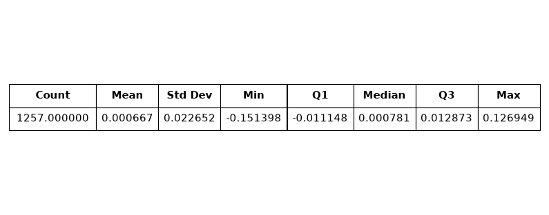
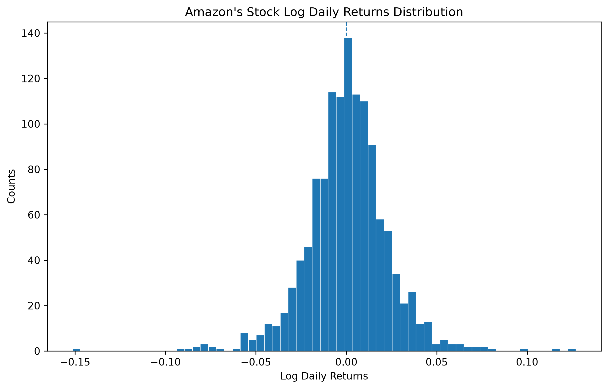
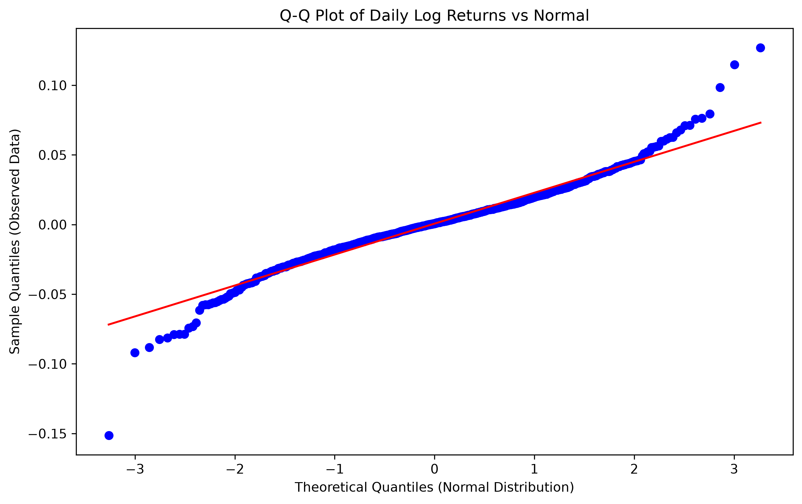
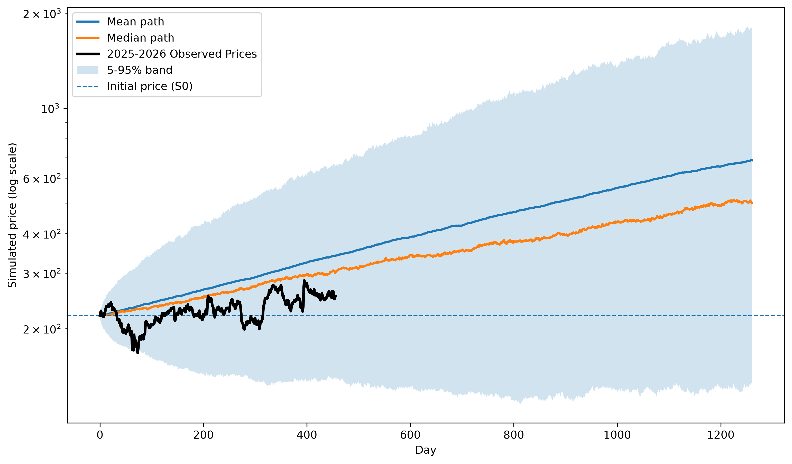
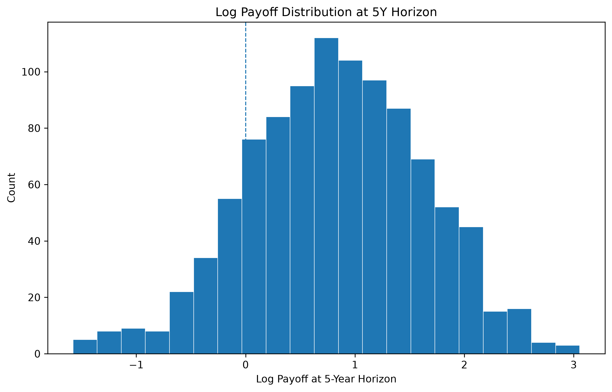
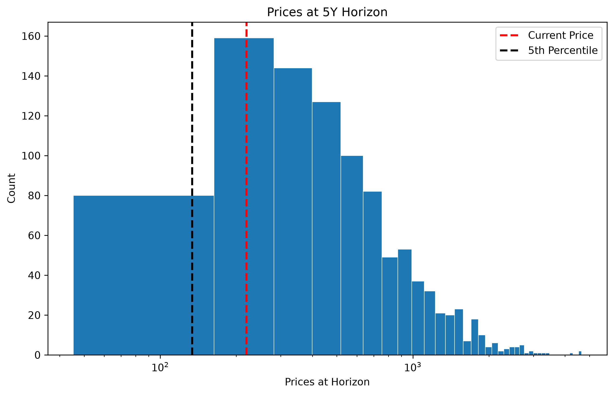
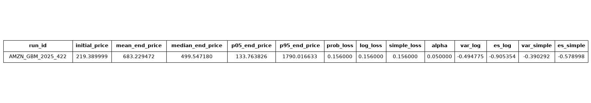
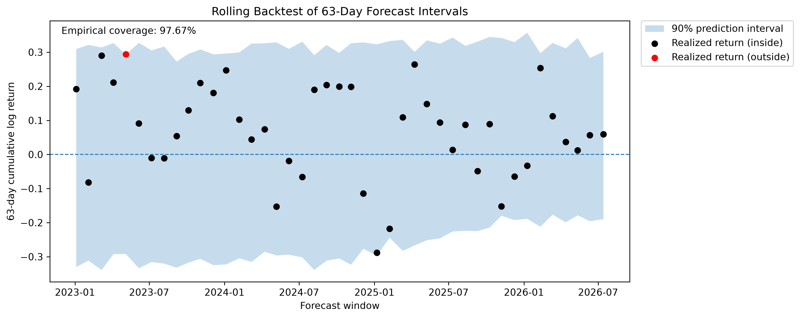
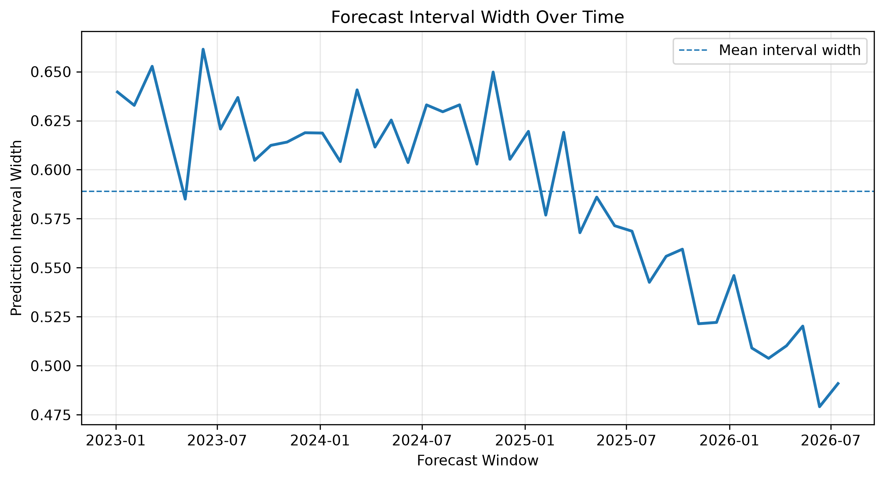
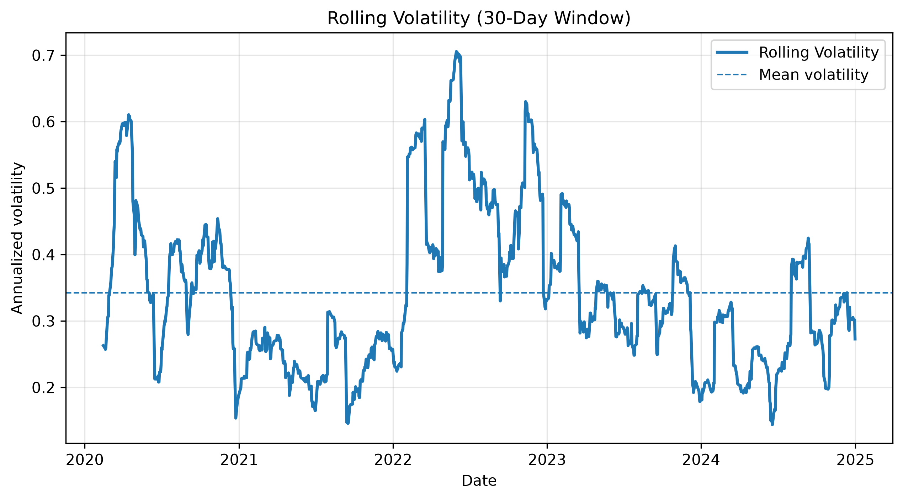

# Monte Carlo Equity Risk Analytics: GBM Simulation, Model Validation, and Volatility Sensitivity

## Project Summary

- **Model:** Geometric Brownian Motion (GBM), Monte Carlo Simulation, Maximum Likelihood Estimation
- **Forecast Horizon:** 5 years (1260 trading days)
- **Simulation Paths:** 1000
- **Backtest:** Rolling window (756-day training, 63-day testing, 21-day step)
- **Risk Metrics:** Value-at-Risk (VaR), Expected Shortfall (ES), probability of loss
- **Analytics Stack:** Python, MySQL, SQL, and Tableau
- **Scenario Analysis:** 1.0×, 1.5×, and 2.0× historical daily volatility

## 1. Introduction
In financial markets, stock prices are influenced by many factors, including macroeconomic policies, geopolitical events, and firm-level performance. Modeling the future behavior of stock prices is therefore challenging due to the complexity and uncertainty of these influences.

Traditional approaches, such as linear regression, can help analyze relationships between variables, but they may not fully capture the stochastic dynamics and inherent uncertainty of asset prices.

To address this, the Geometric Brownian Motion (GBM) framework provides a mathematically robust approach, assuming that asset prices follow a lognormal distribution. This preserves critical real-world properties such as non-negativity and multiplicative compounding. Under this framework, Monte Carlo simulation can be used to generate multiple possible future price paths and analyze the resulting distribution of returns.

In this project, we implement a Monte Carlo simulation to model the future price behavior of Amazon (AMZN) stock and evaluate its risk characteristics, including Value-at-Risk (VaR) and Expected Shortfall (ES). 

## 2. Data
Our target asset in this study is Amazon (AMZN). Historical stock price data are obtained using the `yfinance` API, covering the period from January 1, 2020 to the most recent available trading date. In this project, we use the adjusted closing price, which accounts for corporate actions such as dividends and stock splits and therefore better reflects the true return of the asset.

Based on the adjusted closing prices, we compute daily log returns, which are commonly used in financial modeling due to their desirable statistical properties, including time additivity.

Daily log returns are computed as:

$$r_t = \ln\left(\frac{S_t}{S_{t-1}}\right)$$

where $S_t$ and $S_{t-1}$ denote adjusted closing prices at times $t$ and $t-1$.

  

*Table 1: Descriptive statistics of daily log returns.*

The mean daily log return is approximately 0.00067, while the standard deviation is about 0.02265, indicating that short-term price movements are primarily driven by volatility rather than average drift. These estimated parameters are later used in the Monte Carlo simulation. 

  

*Figure 1: Distribution of Amazon Daily Log Returns*

The histogram indicates that the distribution of daily log returns is centered near zero, though visual symmetry alone does not establish the normality assumption used in the Geometric Brownian Motion framework.

The distribution also exhibits several extreme observations in the tails, which reflect the presence of occasional large market movements.

  

*Figure 2: Q-Q plot of Amazon daily log returns compared with a normal distribution*

The Q-Q plot suggests that the distribution of daily log returns is approximately normal in the central region, as most observations lie close to the 45-degree reference line. However, noticeable deviations appear in the extreme quantiles, indicating the presence of fat tails and occasional extreme return events. Such behavior is commonly observed in financial return series.

Despite empirical tail deviations, the normality assumption provides a tractable baseline approximation for modeling price dynamics under the Geometric Brownian Motion framework.

## 3. Methodology
In this project, the Geometric Brownian Motion (GBM) framework is used, and the stochastic continuous-time model is:

$$dS_t = \mu S_t \, dt + \sigma S_t \, dW_t$$

where $S_t$ denotes the asset price at time $t$, $\mu$ represents the drift (expected return), $\sigma$ denotes volatility, and $W_t$ is a standard Brownian motion.

The discrete solution of GBM is:

$$S_{t+\Delta t} = S_t \exp\left((\mu - \tfrac{1}{2}\sigma^2)\Delta t + \sigma \sqrt{\Delta t} Z_t\right)$$

where 

$$Z_t \sim N(0,1)$$

The continuous-time specification above uses the price-process drift; the implemented simulation instead estimates the **daily mean of log returns** and simulates $r_t\sim\mathcal{N}(\mu_d,\sigma_d^2)$ directly. Accordingly, the $-\tfrac12\sigma^2$ adjustment is already implicit in the distinction between continuous-time price drift and log-return drift and must **not** be subtracted again from the estimated daily log-return mean. The discrete-time solution of the GBM process is used to simulate stock price paths. In this equation, $Z_t$ represents a standard normal random variable. At each time step, a random shock is drawn from the normal distribution and applied to the price dynamics. By repeatedly sampling these shocks, the Monte Carlo simulation generates multiple possible future price paths.

The parameters $\mu$ and $\sigma$ are estimated from historical daily log returns and are used as inputs in the Monte Carlo simulation. 

## 4. Monte Carlo Simulation

Using the estimated parameters from historical data, $\mu$ and $\sigma$, we generate possible future price paths for Amazon stock. In each simulation, random shocks are drawn from a standard normal distribution to represent unpredictable market movements.

For each simulation path, cumulative log returns are calculated by summing the simulated daily log returns over time. The cumulative returns are then converted into simulated future prices by applying the exponential transformation to the initial stock price.

By repeating this process for many independent simulation paths, the Monte Carlo approach produces a distribution of possible future stock prices. This distribution allows us to analyze potential future outcomes and evaluate risk metrics such as Value-at-Risk (VaR) and Expected Shortfall (ES).

A total of 1000 simulation paths are generated over a horizon of 1260 trading days, corresponding to approximately five years of future price evolution.

  

*Figure 3: Monte Carlo simulated future price distribution for Amazon stock under the GBM model. The blue and orange lines represent the mean and median simulated price paths. The shaded region represents the 5-95% prediction interval across simulation paths. The black line shows the observed stock price trajectory from 2025-2026.*

The observed price trajectory from 2025 to 2026 is overlaid on the simulated distribution for comparison. Although the realized path is only partially observed, it remains within the simulated 5-95% prediction interval. This is a descriptive comparison against one partial realized trajectory, not validation of five-year predictive accuracy. However, the observed path fluctuates differently from the simulated central tendency, reflecting the unpredictable nature of real market dynamics.

## 5. Risk Distribution and Risk Metrics

At the end of the simulation horizon, each Monte Carlo path produces a possible terminal stock price and corresponding return. Taken together, these simulated outcomes form an empirical distribution of future prices and losses. This distribution provides a convenient basis for summarizing downside risk, including the probability of loss, Value-at-Risk (VaR), and Expected Shortfall (ES).
To evaluate downside risk, we compute both return-based and price-based summaries. In particular, we examine the probability that the ending price falls below the initial price, as well as tail-risk measures derived from the simulated return distribution.

  

*Figure 4: Distribution of simulated log payoffs at the five-year horizon. The dashed vertical line at zero separates positive and negative payoff outcomes.*

Figure 4 shows that most simulated log payoffs lie above zero, but the left tail remains visible, indicating that negative long-horizon outcomes are less likely than positive ones, yet still non-negligible.

  

*Figure 5: Distribution of simulated terminal prices at the five-year horizon. The red dashed line indicates the initial stock price, and the black dashed line marks the 5th percentile of simulated terminal prices.*

Figure 5 visually highlights the asymmetry of terminal prices: the distribution has a long right tail, while the left side is bounded by the fact that stock prices cannot fall below zero. This helps explain why the mean exceeds the median.

  

*Table 2: Summary of simulated terminal price distribution and downside risk metrics.*

The simulated terminal price distribution is strongly right-skewed. The mean terminal price is approximately 683.23, while the median terminal price is lower at about 499.55. This gap indicates that a relatively small number of high-price simulation paths pull the mean upward, a common feature of lognormal price distributions under the GBM framework.

The 5th percentile of terminal prices is about 133.76, while the 95th percentile is about 1790.02, suggesting a very wide range of possible long-run outcomes. This reflects the compounding effect of uncertainty over a five-year horizon. Even when the daily drift is positive, accumulated volatility creates substantial dispersion in simulated future prices.

The estimated probability that the terminal price falls below the initial price is approximately 15.6%. Equivalently, about 84.4% of simulated paths end above the starting price. Under the assumptions of the model, this suggests that long-run upside remains the more likely scenario, although downside outcomes are still economically meaningful.

To summarize tail risk more formally, we compute Value-at-Risk (VaR) and Expected Shortfall (ES) at the 5% level. For simple returns, the 5% VaR is approximately -39.0%, meaning that 5% of simulated outcomes produce a loss of at least 39.0% over the horizon. The corresponding Expected Shortfall is about -57.9%, indicating that among the worst 5% of outcomes, the average loss is even more severe. The same pattern appears in log-return space, where the 5% VaR is about -49.5% and the Expected Shortfall is about -90.5%.

These results show that although the simulated distribution has substantial upside potential, the left tail remains important. In other words, the model produces a favorable central tendency but also implies that extreme downside outcomes can be severe when they occur.

## 6. Rolling Backtest and Model Validation

The rolling backtest uses 756 historical trading days for each training window, forecasts the following 63 trading days, and advances 21 trading days per iteration. For each window, the simulator re-estimates the daily log-return distribution and computes a nominal 90% prediction interval for the cumulative 63-day log return. Performance diagnostics include interval coverage, interval width, and the probability integral transform (PIT).

In the October 28, 2026 run, **42 of 43 windows** were inside the nominal 90% interval, yielding **97.67% observed coverage**. The sole exception was an **upside** breach in the test window **May 5–August 4, 2023**: realized cumulative log return of approximately **0.29418** slightly exceeded the simulated upper bound of **0.29304** (PIT **0.951**).

*Figure 6: Rolling simulated interval bounds compared with realized cumulative log returns.*

*Figure 7: Rolling 90% interval width over the evaluation period.*

Because the backtest horizons overlap (63-day horizons, 21-day steps), coverage observations are correlated. A 97.67% realized coverage rate is higher than the nominal 90%, but it is not sufficient to conclude that the model is statistically well calibrated or appropriately sharp. Coverage should be considered jointly with interval width and PIT patterns.

## 7. SQL Analytics and Data Pipeline

To extend a Python-only simulation into a reproducible analytics workflow, the project uses Python-to-MySQL ETL with parameterized insert/upsert operations. Six reporting tables store historical prices, run metadata, daily simulation price summaries, horizon metrics, rolling-backtest results, and volatility-scenario outcomes.

The reporting layer uses SQL views such as `vw_forecast_summary`, `vw_risk_metrics`, `vw_backtest_annual`, `vw_backtest_detail`, and `vw_scenario_comparison`. These views isolate dashboard-ready aggregation and formatting logic from the Python simulation code. Repeated runs update existing keys rather than duplicating records. This architecture separates **model computation (Python)**, **persisted analysis and query logic (MySQL/SQL)**, and **presentation (Tableau)**.

The dashboard work consists of two complementary analyses: (1) an equity-risk and model-validation view featuring baseline KPI metrics, a five-year forecast envelope, annual calibration, and exception drilldown; and (2) a volatility stress and risk-sensitivity view comparing scenario loss probability and tail-risk magnitudes. The live MySQL workbook is a local development asset; any Tableau Public publication requires a separate supported public-data publishing path.

## 8. Volatility Scenario Analysis

### 8.1 Experimental design

A controlled volatility sensitivity experiment scales the MLE daily log-return standard deviation while holding its historical daily mean, starting price, simulation horizon (1,260 trading days), number of paths (1,000), and random seed (422) constant. Three volatility multipliers are tested: **1.0×**, **1.5×**, and **2.0×**. Using the same seed makes the scenario paths share the same underlying sequence of standard-normal draws, limiting simulation noise in comparisons.

These scenarios do not represent empirically estimated probabilities of future volatility regimes. Nor does scaling the volatility parameter alone capture a full market crash, return jumps, leverage effects, or changing expected returns.

### 8.2 Scenario outcomes

| Metric | Base (1.0×) | High Volatility (1.5×) | Stress (2.0×) |
|---|---:|---:|---:|
| Daily volatility | 2.2643% | 3.3964% | 4.5286% |
| Mean terminal price | $683.23 | $980.93 | $1,591.58 |
| Median terminal price | $499.55 | $495.28 | $491.05 |
| 5th percentile terminal price | $133.76 | $68.63 | $35.21 |
| 95th percentile terminal price | $1,790.02 | $3,359.46 | $6,304.95 |
| Probability of loss | 15.60% | 24.70% | 30.60% |
| 5% VaR, simple return | −39.03% | −68.72% | −83.95% |
| 5% ES, simple return | −57.90% | −81.56% | −91.81% |

**Finding 1 — Downside exposure grows:** The modeled probability of a negative five-year return increases by **15.0 percentage points**, from 15.6% at baseline to 30.6% at 2× volatility. The worst-tail average return (5% ES) falls from −57.90% to −91.81%.

**Finding 2 — Mean return can be misleading:** The terminal price mean increases sharply with volatility even though the median remains around $500. This reflects the convexity of the exponential transformation under a fixed daily mean of log returns: the growing right tail increases the arithmetic mean, while left-tail outcomes deteriorate. Mean terminal price is not a sufficient risk summary.

**Finding 3 — Scenario analysis informs risk discussion, not investment certainty:** The findings motivate comparing downside metrics with central tendencies, but their magnitudes depend heavily on distribution assumptions and the fixed log-drift design.

## 9. Limitations and Reliability

*Figure 8: Historical rolling volatility illustrates that volatility is not constant across market periods.*

1. **Distribution assumptions:** Independent Gaussian daily log returns do not model the heavy tails evident in the Q-Q plot, jumps, autocorrelation in squared returns, or volatility clustering.
2. **Parameter uncertainty:** Fixed-window estimates from 2020–2024 are treated as known throughout the five-year forecast. Macroeconomic and company-specific changes may invalidate those estimates.
3. **Backtesting dependence:** Overlapping 63-day evaluation windows make interval outcomes non-independent; observed coverage lacks a formal confidence interval and is not an unbiased guarantee of future performance.
4. **Monte Carlo precision:** With 1,000 paths, estimates near the 5% tail depend on relatively few observations. Additional simulation paths and uncertainty bands would improve reliability.
5. **Stress design:** Fixed daily log-return mean plus increased volatility increases arithmetic expected prices via lognormal convexity; this is a modeling artifact of the controlled experiment, not a claim that crises improve expected returns.
6. **Operational scope:** MySQL and Tableau implement a reproducible local analytics workflow, not a continuously updated trading or risk production system.

## 10. Conclusion

The AMZN case study demonstrates an end-to-end risk analytics workflow spanning Python-based stochastic simulation, rolling out-of-sample evaluation, MySQL data persistence, SQL reporting views, and Tableau dashboards. The five-year baseline simulation estimates a **15.6%** loss probability and **−57.9%** simple-return Expected Shortfall at the 5% tail; doubling assumed volatility raises modeled loss probability to **30.6%** and worsens Expected Shortfall to **−91.81%**.

The strongest practical takeaway is not a directional price forecast. It is the importance of evaluating **loss probability and left-tail severity alongside mean and median outcomes**, and of evaluating model coverage alongside interval width. Results remain conditional on a simplified GBM distribution and should be interpreted as analytical scenario comparisons rather than investment advice.
